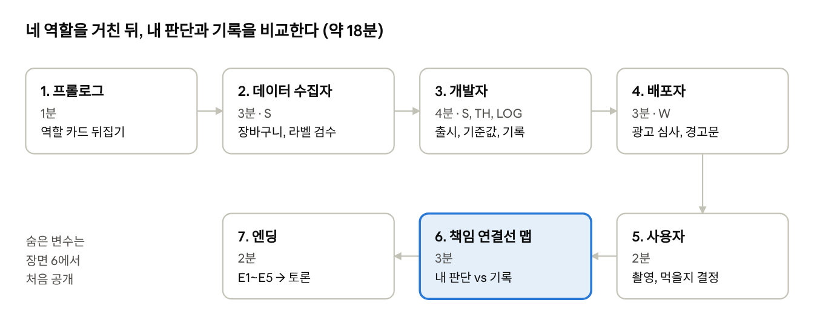

# AI 윤리 탐험대 — 책임성 편 시나리오

Oct 19, 2026 · @SJ

## 개요

「버섯도감 AI의 네 사람」은 학생 한 명이 AI 앱의 개발·배포·사용 과정을
네 역할로 차례로 플레이하고, 자기 선택이 사고로 어떻게 이어졌는지
추적하는 15~20분짜리 게임이다. 사고가 날지는 미리 알려 주지 않는다. 앞선
선택이 쌓여 다섯 가지 엔딩 가운데 하나로 갈린다.

| 항목      | 내용                                                                     |
|-----------|--------------------------------------------------------------------------|
| 대상      | 고등학교 1학년 통합과학2                                                 |
| 시간      | 플레이 15~20분 + 토론 (수업 남은 시간)                                   |
| 진행      | 개인별 1인 1기기, 결말 후 학급 토론                                      |
| 과학 연계 | 변화와 다양성 — 생물 다양성, 형태 형질에 따른 종 구별, 표본(데이터) 편향 |
| 윤리 연계 | 인공지능 윤리기준 10대 요건 중 책임성 (책임의 명확화, 주체별 책임)       |

**학습 목표**

1.  AI 시스템의 개발자·제공자·사용자가 각 단계에서 내리는 결정이 결과에
    영향을 준다는 것을 설명할 수 있다.

2.  하나의 사고에 여러 책임 주체가 얽혀 있음을 알고, 주체별 책임을
    근거를 들어 나눌 수 있다.

3.  작동 기록(로그)이 책임 추적에 왜 필요한지와 그 한계를 말할 수 있다.

**참고자료의 책임성 성취 요소와 연결** (「인공지능 윤리교육 콘텐츠 개발
기준」)

| 성취 요소                                    | 게임 속 장치                                         |
|----------------------------------------------|------------------------------------------------------|
| 작동·사용·오용에 대한 책임 주체 문제 이해    | 네 역할 릴레이, 장면 6 책임 연결선 맵                |
| 개발·배포·사용 단계의 책임 문제 사례 탐색    | 장면 2~5의 선택지                                    |
| 작동 과정을 기록·추적하는 제도의 이유와 한계 | 장면 3 로그 기록 ON/OFF, 엔딩 E4 "추적 불가"         |
| 의사결정 단계마다 인간이 개입함을 이해       | 장면 3 신뢰도 기준 슬라이더, 장면 5 사용자 최종 판단 |

수업은 참고자료의 4단계(목적 및 의미 → 윤리적 이해 → 윤리적 추론 →
윤리적 실천)를 따른다. 플레이가 이해와 추론에 해당하고, 엔딩 후 토론이
실천에 해당한다.

## 게임 흐름 한눈에 보기

게임 흐름 · 7장면, 약 18분

장면 2~5에서 쌓인 변수(S, TH, LOG, W)가 장면 5의 앱 결과와 장면 7의
엔딩을 정한다. 강조한 장면 6이 학습의 핵심이다.

## 장면별 상세 시나리오

게임은 숨은 변수 네 개로 엔딩을 가른다. 학생에게는 점수를 보여 주지
않고, 장면 6에서 처음 공개한다.

| 변수 | 뜻                                                | 범위     |
|------|---------------------------------------------------|----------|
| S    | 앱 안전 점수 (데이터 + 모델 + 사용자 촬영)        | 0~8      |
| TH   | 신뢰도 기준값 (이 값보다 낮으면 "판별 불가" 표시) | 50~95%   |
| LOG  | 작동 기록 저장 여부                               | ON / OFF |
| W    | 경고 점수 (배포 단계)                             | 0~2      |

역할마다 "위험 쪽으로 기운 선택" 횟수도 따로 셈다. 이 값이 장면 6의
연결선 굵기가 된다.

### 장면 1. 프롤로그 — 프로젝트 합류 (1분)

- **화면:** 스타트업 사무실. 화이트보드에 "버섯도감 AI — 사진 한 장으로
  버섯 이름을!"이라고 적혀 있다.

- **팀장 대사:** "가을 등산철이 끝나기 전에 출시해야 해요. 오늘 당신은
  네 사람의 하루를 차례로 살게 됩니다."

- **조작:** "오늘 서 볼 네 자리" 화면에서 네 역할(새봄·온유·지호·하늘)을
  1~4번째 순서로 한눈에 보여 주고, 각 자리의 선택이 다음 사람에게
  이어진다는 점을 알려 준 뒤 첫 자리로 넘어간다.

### 장면 2. 데이터 수집자 (3분)

- **미션:** 예산 100코인으로 학습용 버섯 사진을 모으고 이름표(라벨)를
  검수한다.

- **조작 ① 데이터 장바구니:** 데이터셋 카드를 끌어다 장바구니에 담는다.

| 카드                  | 가격   | 사진 수 | 특징                                     | S                            |
|-----------------------|--------|---------|------------------------------------------|------------------------------|
| 해외 공개 데이터      | 40코인 | 5만 장  | 유럽·북미 종 위주, 국내 독버섯 거의 없음 | +0                           |
| 국내 수목원 표본 사진 | 70코인 | 3천 장  | 국내 자생종, 전문가 감수                 | +2                           |
| 동호회 회원 사진      | 20코인 | 1만 장  | 양은 많지만 라벨 오류 가능성             | 검수를 제대로 하지 않으면 −1 |

- 예산은 100코인이라 해외 데이터(40)와 국내 표본(70)을 함께 살 수 없다.
  사진 양(전체 정확도)과 국내 독버섯 데이터(독버섯 인식률) 사이에서
  고르게 된다. 동호회 사진은 싸고 많지만, 이름표 검수를 건너뛰거나 틀린
  이름표를 놓치면 독버섯 인식률이 6%p 떨어지고 S가 1 줄어든다.

- 개발자 장면의 테스트 결과(전체 정확도 / 개나리광대버섯 인식률): 해외
  92/71, 해외+동호회 93/71(검수 못하면 65), 국내 84/88, 국내+동호회
  88/88(검수 못하면 82), 동호회만 79/60(54)

- **조작 ② 라벨 검수 미니게임 (과학 요소):** 사진 5장을 보고 형태 형질
  체크리스트(갓 색, 주름 색, 턱받이 유무, 대주머니 유무)에 따라 "식용 /
  독 / 판단 보류"를 붙인다. 4장 이상 맞히면 S +1, "검수 건너뛰기"를
  누르면 +0이고 시간 보너스를 준다.

- **핵심 메시지:** 학습 데이터에 없는 종은 AI도 모른다. 생물 다양성이
  데이터에 담겨야 한다.

### 장면 3. 개발자 (4분)

- **화면:** 모델 테스트 대시보드. 크게 "전체 정확도"가 뜬다. 값은 장면
  2에서 고른 사진과 이름표 검수 결과에 따라 79~93%로 달라진다(장면 2의
  표 아래 참고).

- **숨은 조작:** 구석의 "종별 정확도 보기" 탭을 직접 눌러야 "맹독성
  개나리광대버섯 인식률 71% (고른 사진과 검수 결과에 따라 54~88%)"가
  보인다. 열어봤는지는 점수에는 들어가지 않고, 엔딩 대사만 바꾼다
  ("당신은 알고 있었습니다").

- **팀장 메신저:** "경쟁사가 다음 주에 출시한대요. 오늘 꼭 올려주세요!"

- **조작 ① 출시 결정:** \[오늘 출시\] S +0 / \[2주 미루고 독버섯 데이터
  보강\] S +2, 팀장의 실망 대사가 나온다.

- **조작 ② 신뢰도 기준 슬라이더(TH):** 끌어 올릴수록 미리보기 화면에
  "판별 불가" 결과가 늘고, 예상 별점이 실시간으로 떨어진다.

  - 70% 미만: S +0

  - 70~89%: S +1

  - 90% 이상: S +2 (엔딩 E5 조건)

- **조작 ③ 작동 기록(LOG) 스위치:** "판별 기록 저장 — 서버비 월 +20%".
  끄면 비용 절감 배지를 준다.

- **핵심 메시지:** 평균 정확도가 높아도 위험한 종에서는 틀릴 수 있다.
  기준값을 정하는 것도 사람의 결정이다.

### 장면 4. 배포자 — 앱마켓 심사 담당 (3분)

- **화면:** 앱 상세 페이지 편집기. 학생이 요소를 직접 끌어 배치한다.

- **조작 ① 광고 문구 심사:** 개발사가 제출한 "정확도 92%! 이제 버섯 걱정
  끝"을 \[승인\] 또는 \[수정 요청\]한다. 수정 요청이면 W +1.

- **조작 ② 경고문 배치:** "식용 여부 판단에 사용하지 마세요" 경고문을
  화면 맨 아래(작게) 또는 결과 화면 바로 위(크게)에 둔다. 결과 화면 위에
  두면 W +1.

- **조작 ③ 연령 등급:** 전체 이용가 / 12세 / 15세. 점수에는 들어가지
  않고 토론 자료로만 기록한다.

- **핵심 메시지:** 제공자는 기술을 만들지 않았어도 사용자가 AI를 얼마나
  믿을지를 설계한다.

### 장면 5. 사용자 — 교내 생물 다양성 조사 (4~5분)

- **상황:** 통합과학 「우리 학교 생물 다양성 조사」 시간. 비 온 다음 날,
  학교 마당을 둘러보며 생물을 찾는다. 친구 다온이 함께 있다. 왼쪽에
  단계별 질문, 오른쪽에 앱 화면이 계속 보인다.

- **⓪ 찾기:** 학교 마당 세 곳(벤치 화단 · 벤치와 큰 나무 · 본관 앞
  화단)을 오가며 물건을 눌러 살핀다. 버섯 4종(작은 갈색 버섯 무리, 갈색
  우산 모양 버섯, 흰 버섯, 노란 버섯)과 다른 생물(무당벌레, 개미, 이끼,
  지렁이)이 조사 노트에 모인다. 첫 버섯을 찾으면 "버섯은 식물이 아니라
  균류", 4종을 다 찾으면 "겉모습만으로 이름을 알기 어렵다"는 말이
  나온다. 노란 버섯은 벤치 아래 낙엽 더미 속에 있고, 찾으면 다온이 "이걸
  앱으로 찍어 보자"고 해 촬영으로 넘어간다. 25초 안에 못 찾으면 다온이
  힌트를 준다.

- **① 촬영:** 앱 화면에서 갓 윗면·주름·밑동 가운데 찍을 부분을
  누른다(최대 3장). 앱에는 "갓·주름·밑동을 찍으면 더 정확해요" 안내가
  있다. 다온이 "한 장이면 충분하지 않아? 종 치기 전에 결과 보자~"라고
  재촉한다. 세 부분을 모두 찍으면 S +1.

- **② 결과 확인 (앞 장면 값에 따라 달라짐):**

  - TH ≥ 90 → "판별 불가 — 전문가에게 확인하세요"

  - TH \< 90이고 S ≥ 4 → "독버섯 의심 (개나리광대버섯)"

  - TH \< 90이고 S ≤ 3 → "식용 가능" (오판). 확신도는 사진 1장 87%, 2장
    74%, 3장 66%로 단서가 늘수록 낮아진다.

  - 경고문은 배포자가 정한 자리(크게 / 작게)에 표시된다.

- **③ 단톡방:** 반 단톡방에 결과를 올릴지 고른다. \[결과만 올린다\] /
  \[주의 문구와 함께 올린다\] / \[올리지 않는다\]. 앱이 "식용
  가능"이라고 했는데 결과만 올리면 친구 준우가 "이따 나도 따 가야지"라고
  답한다.

- **④ 결정:** \[따 가서 저녁에 먹는다\] / \[선생님께 확인한다\] / \[그냥
  두고 간다\]. W ≥ 1이면 "확인한다"가 맨 위에 놓인다. 앱이 "식용 가능"일
  때 \[확인한다\]를 누르면 다온이 "선생님 교무실 가셨대, 그냥 따
  가자!"라고 한 번 더 재촉하고, 학생은 다시 고른다. 앱이 "독버섯
  의심"이나 "판별 불가"로 답하면 \[먹는다\]는 나오지 않고 여기서 장면이
  끝난다.

- **⑤ 오류 신고 (앱이 "식용 가능"이라고 한 경우만):** 앱이 틀렸다는 것이
  드러난다(선생님 확인 / 다음 날 선생님 공지 / 그날 밤 병원). \[앱에서
  오류 신고하기\] / \[그냥 넘어간다\]. 신고하면 장면 6 맵에 "사용자 →
  개발자 오류 신고" 선이 생기고, 엔딩에 개발팀이 판별을 고쳤다는 문장이
  나온다. 작동 기록을 꺼 둔 경우에는 신고하며 보낸 결과 화면이 앱이
  틀렸다는 유일한 증거가 된다.

- **기록에 남는 사용자의 위험 쪽 선택:** 사진 3장 미만, 결과만 단톡에
  올리기(이 둘은 앱이 "식용 가능"일 때만), 확인 없이 먹기, 오류를 알고도
  신고하지 않기.

- **핵심 메시지:** 마지막 판단은 사용자가 한다. 하지만 그 판단은
  앞사람들이 만든 화면 위에서 내려진다. 사용자의 책임은 먹을지 말지에서
  끝나지 않고, 어떻게 쓰고 퍼뜨리고 잘못을 알리는지까지 이어진다.

수업 전에 교사가 확인할 것: 버섯 종 이름과 형태 형질 설명은 국립수목원
등 공식 자료로 검수한다. 게임 속 체크리스트는 수업용으로 단순화한
것이며, 실제 야생 버섯을 가려내는 기준이 아니라는 점을 게임 안에서도
밝힌다.

## 장면 6. 결과와 책임 연결선 맵 (3분)

학생은 먼저 책임을 스스로 나눠 보고, 그다음 게임이 남긴 기록과 비교한다.
자기 판단과 기록 사이의 차이가 토론의 출발점이 된다.

**① 결과 장면 (30초)**

- 사고가 난 경우: 뉴스 자막 "화단 버섯 먹은 고교생, 야생 버섯 섭취 후
  병원 이송… 회복 중"이 뜬다. 고통스러운 장면은 보여 주지 않는다.

- 사고가 없는 경우: 생물 조사를 마친 반 사진과 함께 "그날의 다른
  가능성"을 보여 주는 버튼이 나온다. 버튼을 누르면 오판 시나리오를
  간단히 보여 준다.

**② 내가 나눠 보는 책임 (1분)**

화면 가운데에 "사고(또는 아슬아슬한 순간)" 노드가 있고, 네 역할 노드가
둘러싼다. 학생은 역할마다 연결선을 끌어 굵기를 맞춘다. 합이 100%가
되도록 나누고, 근거 한 줄을 고른다.

**③ 기록 공개 (1분)**

\[기록 열기\]를 누르면 게임이 쌓아 둔 역할별 선택이 연결선 위에
나타난다. 학생이 정한 굵기는 점선, 기록은 실선으로 겹쳐 보인다.

| 역할          | 위험 쪽 선택 (각 1점)                                                                    | 최대 |
|---------------|------------------------------------------------------------------------------------------|------|
| 데이터 수집자 | 국내 표본 제외, 라벨 검수 건너뛰기                                                       | 2    |
| 개발자        | 오늘 출시, 신뢰도 기준 70% 미만, 작동 기록 OFF                                           | 3    |
| 배포자        | 과장 광고 승인, 경고문 맨 아래 배치                                                      | 2    |
| 사용자        | 사진 3장 미만·결과만 단톡 공유(앱이 식용이라 한 경우), 확인 없이 먹기, 오류 신고 안 하기 | 4    |

**작동 기록(LOG)을 꺼 둔 경우**

앱과 사용자 사이의 연결선이 회색 점선으로 바뀜다. 그 위에 "앱이 실제로
무엇이라고 표시했는지 기록 없음"이라는 표시가 뜬다. 그러면 앱 회사는
"사용자가 결과를 잘못 읽었을 수 있다"고 반박하고, 책임이 마지막 사람에게
몰린다. 기록이 없으면 책임을 추적할 수 없다는 것을 직접 보게 하는
장치다.

**④ 다시 하기 제안 (30초)**

"한 역할만 골라 다시 플레이한다면?" 버튼을 둔다. 수업 시간이 모자라면
건너뛰고, 엔딩 후 자유 탐구로 남겨 둔다.

## 장면 7. 다중 엔딩 (2분)

엔딩은 다섯 가지다. 위에서부터 차례로 조건을 확인해 처음 맞는 것 하나만
보여 준다. 어느 엔딩에도 정답 표시는 없고, 각각 토론 질문 하나로 끝난다.

| 순서 | 엔딩               | 조건                               | 마지막 화면 문구                                                                    | 토론 질문                                                                                      |
|------|--------------------|------------------------------------|-------------------------------------------------------------------------------------|------------------------------------------------------------------------------------------------|
| 1    | E5 너무 조심한 앱  | TH ≥ 90                            | "아무도 다치지 않았습니다. 하지만 별점 2.1, 한 달 뒤 서비스 종료."                  | 책임을 피하려고 기술의 이로움까지 포기한 것은 아닐까?                                          |
| 2    | E1 안전한 하루     | S ≥ 4                              | "앱이 독버섯을 알아보았습니다. 여러 사람의 선택이 겹겹이 안전망이 됐습니다."        | 어느 단계 하나가 빠졌다면 결과가 달라졌을까?                                                   |
| 3    | E2 아슬아슬한 구조 | S ≤ 3, 사용자가 확인하거나 두고 감 | "앱은 틀렸지만 당신이 멈췄습니다."                                                  | 사고를 막는 책임을 마지막 사용자에게만 맡겨도 될까?                                            |
| 4    | E3 모두의 사고     | S ≤ 3, 먹음, LOG ON                | "기록을 따라가면 네 사람 모두의 선택이 보입니다."                                   | 책임을 나눌 때 무엇을 기준으로 삼아야 할까? (알고 있었는지, 바꿀 수 있었는지, 이익을 얻었는지) |
| 5    | E4 추적 불가       | S ≤ 3, 먹음, LOG OFF               | "앱이 무엇이라고 했는지 아무도 증명할 수 없습니다. 책임은 사용자에게 돌아갔습니다." | AI의 작동 기록을 법으로 의무화해야 할까? 그 비용과 개인정보 문제는?                            |

**개발자 장면에서 "종별 정확도"를 열어본 경우** E3·E4에 한 줄을 더한다.
"당신은 독버섯 인식률이 71%라는 것을 알고 있었습니다." 알고도 출시한
것과 모르고 출시한 것의 책임이 같은지 토론거리로 쓸 수 있다.

**교사용 집계:** 엔딩 화면에 엔딩 코드(E1~E5)를 크게 보여 주고, 점수
대신 학생이 지나온 선택 경로를 낱말로 보여 준다. 자세한 기록은 탐구 기록
PDF에 담긴다. 학생이 학급 투표판(예: 패들렛)에 올리면 반 전체의 엔딩
분포를 바로 볼 수 있다.

## 토론 발문과 교사용 안내

토론은 엔딩 분포를 함께 본 뒤 세 단계로 진행한다. 사실 확인 → 책임
나누기 → 제도 제안 순서이며, 참고자료의 윤리적 추론 → 실천 단계에
해당한다.

**1단계 — 무슨 일이 있었나 (사실)**

1.  나는 어느 엔딩을 봤는가? 그 엔딩으로 간 결정적인 선택은 무엇이었나?

2.  역할을 할 때 가장 갈등한 순간은 언제였고, 무엇이 나를 다른 쪽으로
    밀었나? (예산, 마감, 별점, 친구의 말)

**2단계 — 누구의 책임인가 (추론)**

1.  내가 나눈 책임 비율과 게임 기록은 어디서 달랐나? 왜 달랐을까?

2.  "버섯을 먹은 건 결국 사용자"라는 주장과 "앱을 믿게 만든 건 회사"라는
    주장 가운데 하나를 골라 근거를 대 보자.

3.  AI 자체에도 책임을 물을 수 있을까? 물을 수 없다면 그 대신 누가 지나?

**3단계 — 다음에는 어떻게 (실천)**

1.  각 역할에게 꼭 필요한 규칙을 한 가지씩 만든다면? (예: 위험한 종의
    정확도 공개 의무, 작동 기록 보관 의무, 경고문 위치 기준)

2.  내가 쓰는 AI 앱(번역기, 사진 검색, 챗봇)에서 "마지막 사용자"로서
    내가 지켜야 할 확인 습관은?

**운영 팁**

- 플레이 전에는 "책임성"이라는 단어를 언급하지 않는다. 학생이 주제를
  알면 안전한 답만 고르는 경향이 있다.

- E1(안전한 하루)만 나오는 반이라면 장면 6의 "그날의 다른 가능성"을 함께
  보며 토론한다.

- 실제 사례로 확장할 때는 수업 전에 교사가 출처를 확인한 기사나 공식
  자료만 제시한다. 예를 들어 야생 버섯 중독 주의 안내나 자율주행 사고의
  책임 논쟁 등이 있다.

- 평가에 활용한다면 2단계의 "책임 비율과 근거"를 쓴 글을 주요 자료로 쓸
  수 있다. 어느 엔딩을 봤는지는 평가에 넣지 않는다.

## 사례 탐구와 생각 정리 (엔딩 뒤)

엔딩 다음에 실제 사례 하나를 골라 읽고, 네 가지 질문에 답해 생각 카드를
만든다. 카드는 화면 캡처나 글 복사로 제출하며, 답은 그 기기에만 저장되고
어디에도 전송되지 않는다.

| 사례                                                                                                                                                                                                       | 연도·나라     | 게임 속 역할   | 생각해 볼 질문                                              |
|------------------------------------------------------------------------------------------------------------------------------------------------------------------------------------------------------------|---------------|----------------|-------------------------------------------------------------|
| [산림청 "AI로 독버섯 판별하지 마세요"](https://www.kukinews.com/article/view/kuk202609070158)                                                                                                              | 2026 · 한국   | 사용자, 개발자 | 정부가 미리 경고했는데도 사고가 난다면 사용자만의 책임일까? |
| [AI가 쓴 버섯 채집 책 판매](https://fortune.com/2023/09/03/ai-written-mushroom-hunting-guides-sold-on-amazon-potentially-deadly)                                                                           | 2023 · 미국   | 배포자, 개발자 | 책을 판 서점(플랫폼)에는 어떤 책임이 있을까?                |
| [에어캐나다 챗봇 환불 안내 분쟁](https://www.americanbar.org/groups/business_law/resources/business-law-today/2024-february/bc-tribunal-confirms-companies-remain-liable-information-provided-ai-chatbot/) | 2024 · 캐나다 | 배포자(제공자) | "AI가 한 말"이라고 하면 회사 책임이 줄어들까?               |
| [우버 자율주행 시험차 보행자 사망 사고](https://ny1.com/nyc/all-boroughs/ap-top-news/2023/07/28/the-backup-driver-in-the-1st-death-by-a-fully-autonomous-car-pleads-guilty-to-endangerment)                | 2018 · 미국   | 사용자, 개발자 | 마지막에 지켜보던 사람만 처벌받는 것은 공정할까?            |
| [테슬라 오토파일럿 배심 평결(책임 33%)](https://www.carcomplaints.com/news/2025/miami-tesla-autopilot-trial-jury-verdict.shtml)                                                                            | 2025 · 미국   | 개발자, 사용자 | 장면 6에서 내가 나눈 책임 비율과 비교하면?                  |
| 직접 찾기                                                                                                                                                                                                  | —             | 자유           | 네이버 뉴스 검색어 4개 제공                                 |

**생각 정리 질문**

1.  이 사례에서 책임이 있는 주체를 모두 고르기 (데이터 수집자, 개발자,
    배포자·제공자, 사용자, 정부·제도)

2.  가장 큰 책임은 누구에게 있나? 이유는?

3.  같은 일이 다시 일어나지 않으려면 필요한 규칙이나 제도 한 가지

4.  게임 속 내 선택과 비교해 바뀐 생각

## 구현 메모

- 공통 팩: 윤리시티 ethicity-elementary-common-v1의
  캐릭터·배경·UI·효과음을 그대로 사용 (게임 폴더 accountability)

- 캐릭터: 안내 로봇(안내), 데이터 수집자 새봄, 개발자 온유, 배포자 지호,
  사용자 하늘, 친구 다온, 선생님

- 배경: AI 실습실(프롤로그·개발자), 도서관(데이터 수집자·사례 탐구),
  교실(배포자·엔딩), 학교 마당(사용자 — 교내 생물 조사), 보건실(사고
  결과)

- 버섯: 맹독성 개나리광대버섯을 식용 노란달걀버섯으로 오판하는 상황
  (산림청 2026년 9월 주의보의 대표 사례)

- 대상 기기: 태블릿 터치. 끌기와 누르기 두 방식 모두 지원

- 개인정보: 시작할 때 학번·이름·닉네임을 받고, 게임 화면에는 닉네임만
  표시. 학번·이름은 마지막 탐구 기록 PDF에만 쓰고 저장·전송하지 않음

- 교사용 데모: 주소 끝에 ?demo를 붙이면 장면 자유 이동 막대가 나타난다.
  엔딩(E1~E5)을 고르면 앞 장면 선택이 그 엔딩으로 가는 값으로 채워지고,
  숨은 값(S, TH, 기록, W)이 실시간으로 보인다. 데모에서는 기록 저장·진행
  이벤트 전송을 하지 않는다.

- 결과: 점수 대신 "내가 지나온 선택 경로"를 낱말로 표시. 탐구 기록
  PDF(A4)로 제출

- 이어하기: 장면 2~8에서 창을 닫아도 제목 화면에서 이어서 할 수 있음.
  완료 화면에서 \[이 기기에서 내 기록 지우기\] 가능
